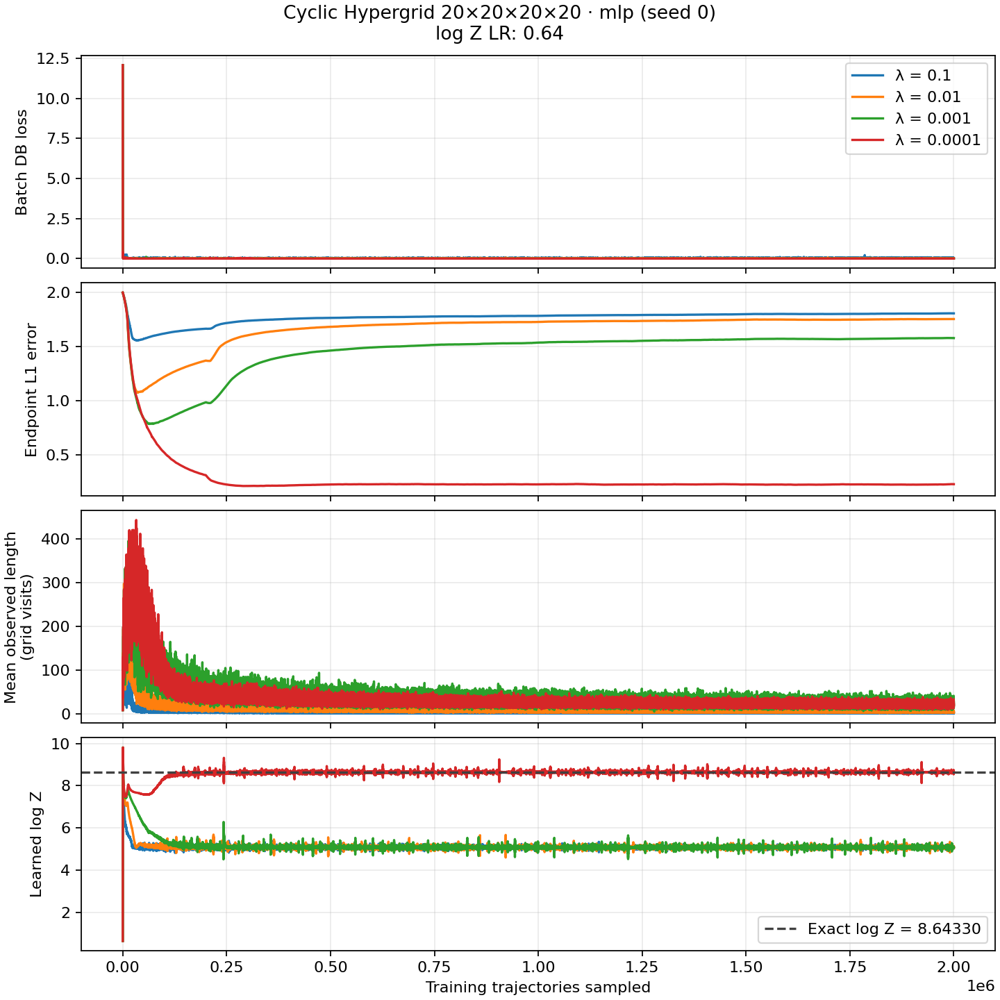
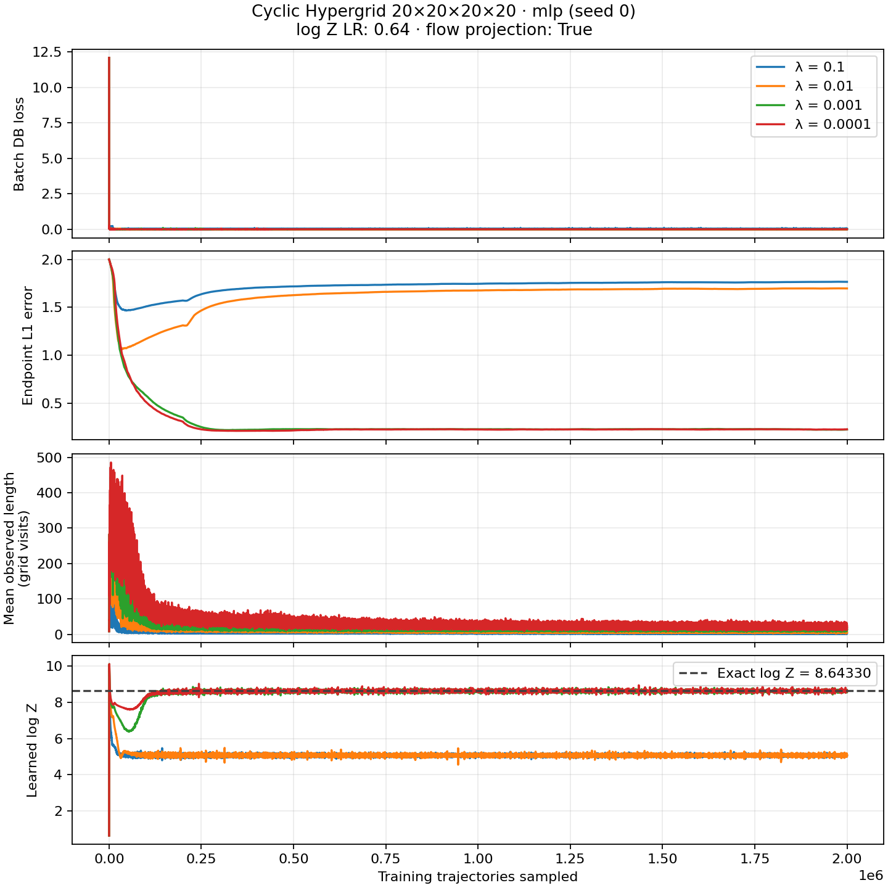

# Эксперименты

## Hypergrid: регуляризация потока и проекция градиента

Цель — проверить, помогает ли проекция уменьшать поток без потери сходимости к распределению `R(x)/Z`.

Общий сетап

- Циклический Hypergrid `20×20×20×20`, MLP с двумя скрытыми слоями по 256 нейронов.
- Adam, `lr=0.001`, отдельный `lr=0.64` для скалярного `log_z`, `seed=0`.
- 125 000 шагов, батч 16 траекторий — всего 2 000 000 траекторий на каждый λ.
- Максимальная длина — 512 позиций, окно для endpoint L1 — 200 000 последних траекторий. L1 считается по завершённым траекториям в окне.
- Коэффициенты регуляризации `λ ∈ {0.1, 0.01, 0.001, 0.0001}`. Штраф — средний поток по посещениям состояний.
- На графиках показаны DB loss, endpoint L1, средняя наблюдаемая длина и `log_z`. Точное значение `log Z ≈ 8.64330` отмечено пунктиром.

### 1. Без проекции

Обучение по сумме `DB loss + λ · flow loss`. Логи — `runs/baseline`.

При `λ=0.0001` значение `log_z` приближается к точному, а L1 снижается примерно до 0.23. При `λ=0.001` обучение выходит на неверное решение — `log_z ≈ 5` и L1 около 1.6. При `λ=0.01` и `λ=0.1` также наблюдаются заниженный `log_z` и большая L1-ошибка, несмотря на малый DB loss на обучающих батчах.

### 2. С проекцией

Тот же сетап с `--project-flow-gradient`. Конфликтующая компонента градиента потока проецируется на гиперплоскость, перпендикулярную градиенту DB. Дополнительно проецируется обновление после Adam, если оно направлено на увеличение DB в линейном приближении. Логи — `runs/flow_projection`.

При `λ=0.001` обучение теперь сходится к правильному решению по наблюдаемым метрикам — `log_z` приближается к точному, а L1 снижается примерно до уровня запуска с `λ=0.0001`. При `λ=0.01` и `λ=0.1` сохраняются заниженный `log_z` и большая L1-ошибка.

Batch DB loss в конце обучения

В таблице приведён чистый DB loss без штрафа за поток. Среднее посчитано по 100 залогированным батчам за последние 10 000 шагов.

| λ | Без проекции, среднее | С проекцией, среднее | Без проекции, последний батч | С проекцией, последний батч |
|---|---:|---:|---:|---:|
| 0.0001 | 9.78·10⁻⁵ | 9.47·10⁻⁵ | 2.13·10⁻⁴ | 1.09·10⁻⁴ |
| 0.001 | 5.54·10⁻⁴ | 2.78·10⁻⁴ | 1.46·10⁻⁴ | 3.86·10⁻⁴ |
| 0.01 | 2.17·10⁻³ | 1.55·10⁻³ | 9.40·10⁻⁴ | 3.53·10⁻³ |
| 0.1 | 1.04·10⁻² | 6.90·10⁻³ | 1.98·10⁻² | 3.75·10⁻² |

При `λ=0.001` проекция уменьшила средний DB примерно вдвое. При больших λ средний DB тоже снизился, но этого оказалось недостаточно для правильного распределения и `log_z`.

**Вывод.** Проекция может помогать — в этом сравнении она позволила получить сходимость при `λ=0.001`. Однако при больших λ обучение всё равно сходится к неверному решению, поэтому проекция в текущем виде не является окончательным решением проблемы. Вывод пока основан на одном seed.

### Идея для дальнейшей проверки

Стоит разобраться, к какому именно неверному решению сходится обучение при больших λ.

Я предполагаю, что модель начинает игнорировать некоторые состояния с большим ревардом, таким образом получая меньший $\log Z$ и меньший суммарный поток. При этом если модель никогда не завершает путь в этих состояниях, то в лосс не добавляется ошибка за эти состояния. Таким образом такое игнорирование является локальных оптимумом по лоссу, но оно далеко от ожидаемого оптимального решения.

Для проверки стоит сравнить частоты завершений с `R(x)/Z`, особенно в состояниях с большим ревардом, и отдельно оценить терминальные DB-невязки в этих состояниях независимо от on-policy завершений.
